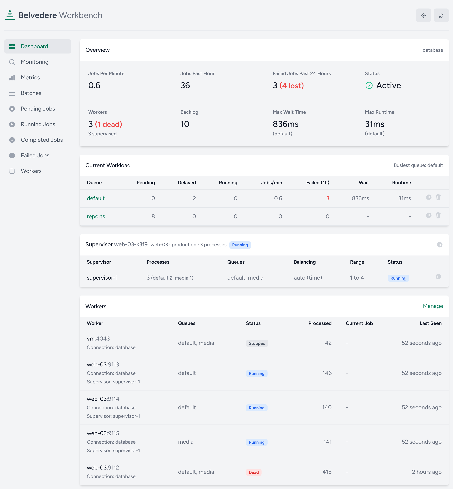
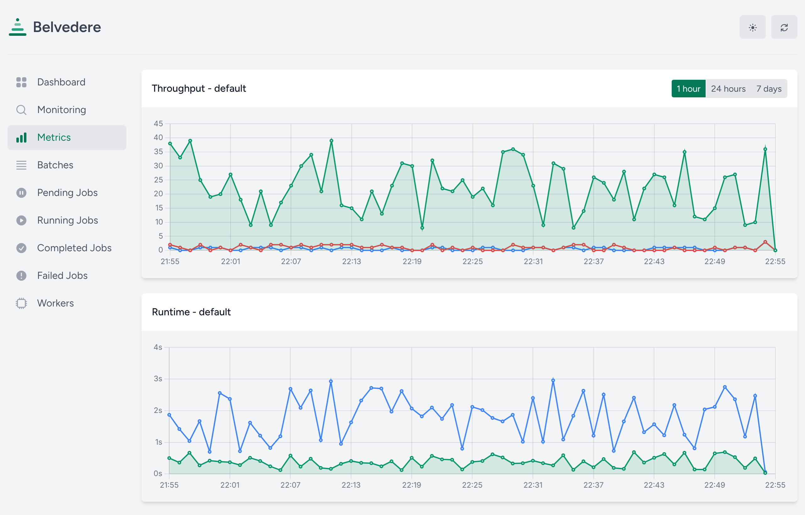
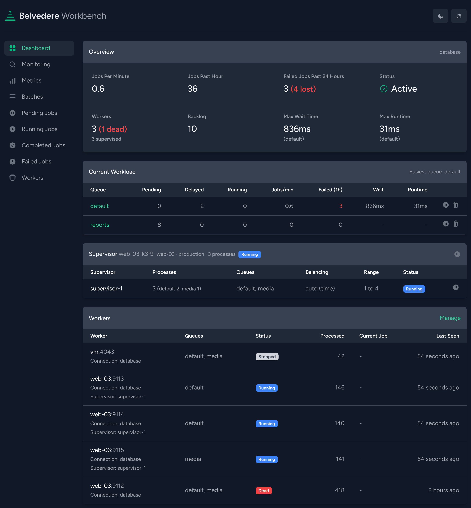

# Belvedere

Horizon-style queue dashboard for Laravel's `database` queue driver.

Horizon only works with Redis. Belvedere gives applications that run on the `database` driver (Laravel's default since version 11) the same visibility and the same actions: pending, running, completed and failed jobs, batches, workers, per-queue metrics, retries, purges and queue pausing. No Redis, no Node, no third-party service.



> **Status:** pre-release. The collector, storage, JSON API, commands, alerts and the dashboard are complete and tested; the package has not been tagged yet.

## Requirements

- PHP 8.2+
- Laravel 12 or 13 (Laravel 11 no longer receives security fixes and Composer refuses to install it by default)
- MySQL 8.0 or newer (tested on 8.4 LTS and 9.7 LTS), MariaDB (tested on 11.8), PostgreSQL (tested on 17) or SQLite

## Installation

```bash
composer require alexisgeneau/laravel-belvedere
php artisan belvedere:install
php artisan migrate
```

The dashboard is served at `/belvedere` with its assets inlined, so there is nothing to publish and nothing to refresh after an update. Outside the `local` environment, access is denied until you define the `viewBelvedere` gate:

```php
use Illuminate\Support\Facades\Gate;

Gate::define('viewBelvedere', fn ($user) => in_array($user->email, ['you@example.com']));
```

or register a callback:

```php
use Belvedere\Belvedere;

Belvedere::auth(fn ($request) => $request->user()?->isAdmin() ?? false);
```

Add the two commands to your scheduler:

```php
Schedule::command('belvedere:prune')->daily();
Schedule::command('belvedere:check')->everyMinute();
```

## Dashboard

The interface is a fork of Horizon's, with the same layout and the same screens so nobody has to relearn anything: Dashboard (throughput, backlog, workers, per-queue workload with pause, resume and purge), Monitoring (tags), Metrics (throughput, runtime and wait time charts by job or by queue over 1 hour, 24 hours or 7 days), Batches, Pending Jobs (pending and delayed), Running Jobs (running and stuck), Completed Jobs (with released, timed-out and lost attempts), Failed Jobs (search, retry, retry all, flush) and Workers.

Every list refreshes itself (`refresh_seconds`), follows the system color scheme with a light/dark toggle, and can switch between observed connections. With `read_only` enabled, every action disappears from the interface and the API rejects it.

If the application sends a `Content-Security-Policy` header, call `Vite::useCspNonce()` in a middleware: Belvedere reuses that nonce on its inline style and script tags.





## How it works

Belvedere listens to the queue events Laravel already dispatches (`JobQueued`, `JobProcessing`, `JobProcessed`, `JobFailed`, `JobReleasedAfterException`, `JobTimedOut`, `Looping`, `WorkerStopping`, `QueueBusy`) and stores one row per job execution in its own tables (`belvedere_jobs`, `belvedere_job_tags`, `belvedere_workers`, `belvedere_metrics`, `belvedere_actions`, `belvedere_monitored_tags`). Live state (pending, delayed, running, stuck) is read straight from Laravel's `jobs`, `failed_jobs` and `job_batches` tables, which are never modified except through the actions you trigger.

Tags follow Horizon's convention: a `tags()` method on the job, otherwise the Eloquent models found in its public properties. Tags, the batch id and a redacted snapshot of the job's public properties are computed when Laravel builds the payload (`Queue::createPayloadUsing`) and stored under its `belvedere` key, so they travel with the job through bulk pushes, batches and `queue:retry`. Jobs implementing `ShouldBeEncrypted` get tags but no snapshot. Payloads are never unserialized in the web process.

Cost per job: one `INSERT` when the job is queued (plus one for its tags), one `UPDATE` when it starts and one when it finishes. Metrics are accumulated in memory by each worker and flushed at most every 5 seconds, so a worker killed with `SIGKILL` loses at most a few seconds of them. Use `sampling`, disable snapshots or point `storage.connection` to a dedicated database to lower the cost further.

### Lost executions

An execution whose outcome never arrives is marked **lost** instead of staying "running" or "queued" forever. `belvedere:check` does it every minute: a running execution is lost once its worker is reported dead or stopped, once a later attempt of the same job exists, or once it is older than the connection's `retry_after` (the queue has released the job by then); a queued execution is lost once its job has left the `jobs` table without being processed, which only happens when the queue is cleared or the job deleted outside the dashboard. Deleting or purging jobs and forgetting a worker from the dashboard mark the matching executions on the spot. The reason is stored where the exception would be, lost executions have their own tab under Completed Jobs and a counter on the dashboard, and they follow the `completed` retention. A worker that reports late overrides the verdict, and a queued execution is revived if its job runs after all.

## Configuration

`config/belvedere.php`:

| Key | Default | Purpose |
| --- | --- | --- |
| `enabled` | `true` | Collect queue events and payload metadata (the dashboard itself stays available) |
| `path` | `belvedere` | URI prefix of the dashboard and its API |
| `middleware` | `['web']` | Middleware applied before the authorization check |
| `read_only` | `false` | Disable every action while keeping the dashboard readable |
| `connections` | `['database']` | Queue connections to observe |
| `storage.connection` | `null` | Database connection for Belvedere's tables (`null` = default) |
| `storage.prefix` | `belvedere_` | Table prefix |
| `sampling` | `1` | Record one job out of *n* (metrics stay exact for sampled jobs only) |
| `snapshot.*` | enabled, 16 KB, common secret keys | Snapshot of the job's public properties |
| `retention.*` | 7 days completed (released, timed-out and lost included), 30 days failed | Retention applied by `belvedere:prune` |
| `workers.dead_after_seconds` | `90` | A worker without heartbeat for this long is reported dead |
| `alerts.*` | mail / Slack routes, thresholds, cooldown | Alerts evaluated by `belvedere:check` |

## Queue pausing

Pausing a queue sets a flag in the cache. Every `queue:work` process checks it through the `Looping` hook and sleeps while **all** the queues it consumes are paused. A worker started with `--queue=high,default` keeps running while only `high` is paused.

## Other queue drivers

On `redis`, `sqs` or `beanstalkd`, Belvedere still records history, metrics, failures and workers from the events, but the live lists come from the database driver only: the dashboard shows the queue size and marks the connection as degraded.

## Retrying failed jobs

A retry pushes the stored payload back with its attempts reset, exactly like `queue:retry`, and keeps the job UUID so batches stay consistent. Because the payload is not unserialized, a `retryUntil` deadline is dropped: the retried job then relies on `tries`.

## Commands

| Command | Purpose |
| --- | --- |
| `belvedere:install` | Publish the configuration and the migration |
| `belvedere:status` | Print every queue and the worker count in the console |
| `belvedere:check` | Mark lost executions, then evaluate backlogs, failure rates and dead workers and send alerts |
| `belvedere:prune` | Apply the retention periods |
| `belvedere:clear` | Delete everything Belvedere stored |

## JSON API

Every endpoint lives under `/belvedere/api` and accepts `?connection=` when several connections are observed.

| Method | Path | Purpose |
| --- | --- | --- |
| GET | `overview` | Counts, throughput, wait and run times per queue, worker summary |
| GET | `queues` | Per-queue counts and pause state |
| POST | `queues/{connection}/{queue}/pause` · `/resume` | Pause or resume a queue |
| DELETE | `queues/{connection}/{queue}` | Purge the pending jobs of a queue |
| GET | `jobs/pending` · `delayed` · `running` · `stuck` | Live jobs from the `jobs` table |
| DELETE | `jobs/{connection}/{id}` | Delete a pending job |
| POST | `jobs/{connection}/{id}/run-now` · `/release` | Make a delayed job available now, release a stuck job |
| GET | `jobs/history` · `jobs/history/{uuid}` | Processed jobs with filters, detail with every attempt |
| GET | `jobs/failed` · `jobs/failed/{id}` | Failed jobs with filters, detail with the exception |
| POST | `jobs/failed/{id}/retry` · `jobs/failed/retry` | Retry one job, a list of `ids` or the current filter |
| DELETE | `jobs/failed/{id}` · `jobs/failed` | Forget one failed job or flush them all |
| GET | `batches` · `batches/{id}` | Batches with progress |
| POST | `batches/{id}/cancel` · `/retry` | Cancel a batch, retry its failed jobs |
| GET | `workers` | Workers with their status and current job |
| DELETE | `workers/{id}` | Forget a dead worker |
| GET | `metrics/{queue\|job}` · `metrics/{type}/{name}?range=1h\|24h\|7d` | Aggregates and time series |
| GET/POST/DELETE | `monitoring` · `monitoring/{tag}` · `monitoring/{tag}/jobs` | Monitored tags and their jobs |

## Development

```bash
composer install
composer test      # Pest
composer analyse   # PHPStan (Larastan, level 6)
composer lint      # Pint
```

The front end lives in `resources/js` and `resources/sass` (Vue 3, Vite, Bootstrap, Chart.js) and is compiled into `resources/dist`, which is committed; the CI fails when the committed build no longer matches the sources:

```bash
npm install
npm run build
npm run test:ui    # Playwright smoke test of every screen against the workbench
```

To try the dashboard against a disposable application seeded with sample jobs:

```bash
composer serve
```

then open `http://127.0.0.1:8000/belvedere`.

`composer bench` measures the overhead per job against a run with the collector disabled, the latency of every read endpoint once the history holds a million rows, and the duration of `belvedere:prune`. It runs on SQLite by default; set `BENCH_DB_CONNECTION=mysql` or `pgsql` with `BENCH_DB_HOST`, `BENCH_DB_PORT`, `BENCH_DB_DATABASE`, `BENCH_DB_USERNAME` and `BENCH_DB_PASSWORD` to measure the database you run in production. The script drops and recreates the queue and Belvedere tables of that database.

## License

MIT. The user interface is derived from [Laravel Horizon](https://github.com/laravel/horizon), also published under the MIT license; see `LICENSE.md`.
